<div align="center">

# quickRS

**A free practice player for your own Rocksmith 2014 songs.**
Plug in your guitar, pick a song, and play along to tab that scrolls with the music.

[**⬇ Download for Windows**](https://github.com/arpan2711/quickRS-player/releases/latest) · [Get your songs in](#get-your-songs-in) · [Converter](#the-converter-psarc--feedpak) · [☕ Support it](https://ko-fi.com/arpanmitra)

</div>

## Get your songs in

1. **Download** `quickRS-<version>-windows-x64.zip` from
   [Releases](https://github.com/arpan2711/quickRS-player/releases/latest) and unzip it anywhere. There's no
   installer.
2. **Add the keys.** Rocksmith's .psarc files are encrypted, and the keys aren't included. They're published in
   open-source Rocksmith modding tools. Copy `keys.example.json` to `keys.json`, next to `quickrs.exe`, and paste
   in the two keys:
   ```json
   { "psarc_key": "<64 hex characters>", "sng_key": "<64 hex characters>" }
   ```
3. **Run `quickrs.exe`.** Your songs in Rocksmith's `dlc` folder are listed straight away, with nothing to convert
   or set up. Songs somewhere else? Drag that folder onto the quickRS window and it stays in your library.
4. **Optional: convert them to feedpaks** with **`quickRS Converter.exe`** (below).

Windows may warn about an unsigned app the first time: click *More info*, then *Run anyway*. For a Desktop
shortcut, right-click `make_shortcut.ps1` and choose *Run with PowerShell*.
**Needs:** Windows 10 or 11 (64-bit), your guitar (a Real Tone Cable, an audio interface, or a mic), and your own
Rocksmith 2014 songs. **No songs are included.**

| Dark | Light |
|---|---|
| 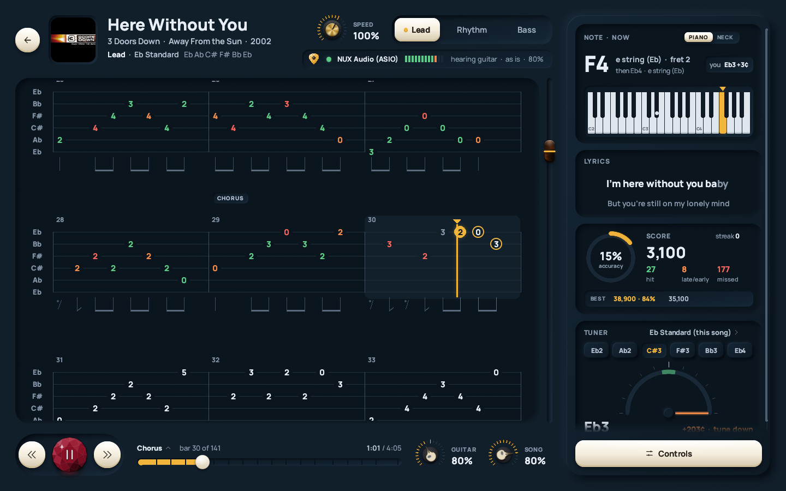 | 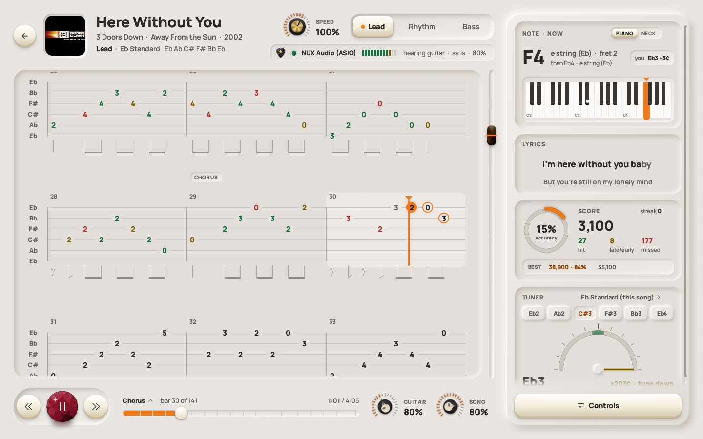 |

## The converter: psarc → feedpak

**Feedpaks** are an open format for the same songs: one plain, unencrypted zip per song, with every part and
difficulty, the audio, lyrics and cover. Once converted, they play without keys. Your .psarc files are only read,
never changed, so Rocksmith keeps working as before.


**How to use it:**

1. Double-click **`quickRS Converter.exe`** (it's in the zip, next to `quickrs.exe`).
2. Check the top line says **Keys found**. If it says *keys.json is missing*, do step 2 above, then press
   *Check again*.
3. **Your Rocksmith songs:** Rocksmith's `dlc` folder is filled in when it's found. If it isn't, press *Browse…*
   and pick the folder with your .psarc files.
4. **Where the feedpaks go:** it fills in a `feedpak` folder next to `dlc`. **Leave it** and quickRS finds your
   feedpaks by itself, with nothing to set up. If you choose somewhere else, drag that folder onto the quickRS
   window once afterwards.
5. Press **Convert**. Each song shows as it's done, and *Open the feedpak folder* shows you the result.

It converts every song, including those in subfolders and every song in packs like `songs.psarc`. Run it again
after buying or adding songs, and only the new ones are converted. If you have a song as both a .psarc and a
feedpak, quickRS shows it once, and *Settings → Library* chooses which copy plays.

**No window?** `Convert songs.bat` does the same in a console: double-click it and press Enter twice. From a
command prompt:

```bat
quickrs-cli.exe convert-folder "C:\...\Rocksmith2014\dlc" "C:\...\Rocksmith2014\feedpak"
```

---

## What it does

quickRS reads the songs you already have and turns them into a fast, clean practice tool. It runs next to your
Rocksmith install and never changes it.

### 🎸 Play along to real tab
The tab scrolls with the song and highlights the bar you're in, with the next notes ringed. The Lead, Rhythm and
Bass parts are one click apart, and the rhythm notation is drawn under the staff. A **note and chord panel** shows
what's coming on a piano or a guitar neck, next to the **lyrics** and a **tuner** set to the song's tuning.

| Dark | Light |
|---|---|
|  | 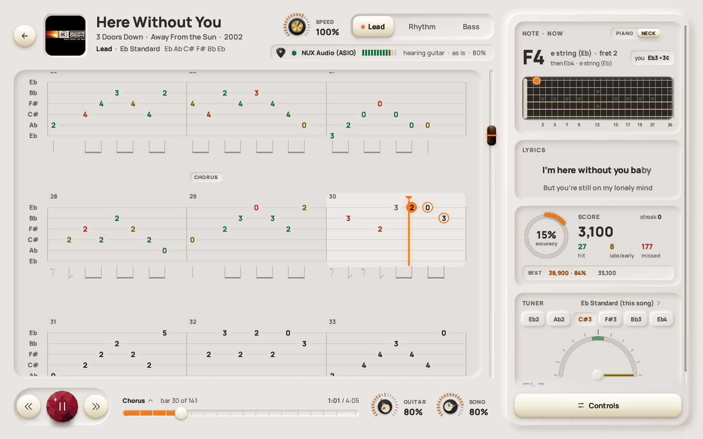 |

### 🔁 Loop it, slow it down, level up
Drag across the tab to select a few bars and loop them. Slow the loop down **without changing the pitch**. Turn
on *Level up after a clean loop* and the difficulty steps up each time you nail it.

| Dark | Light |
|---|---|
|  | 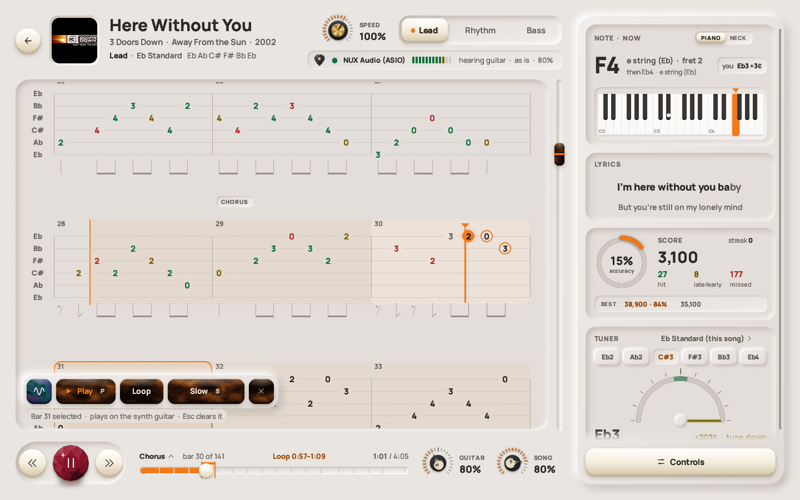 |
|  | 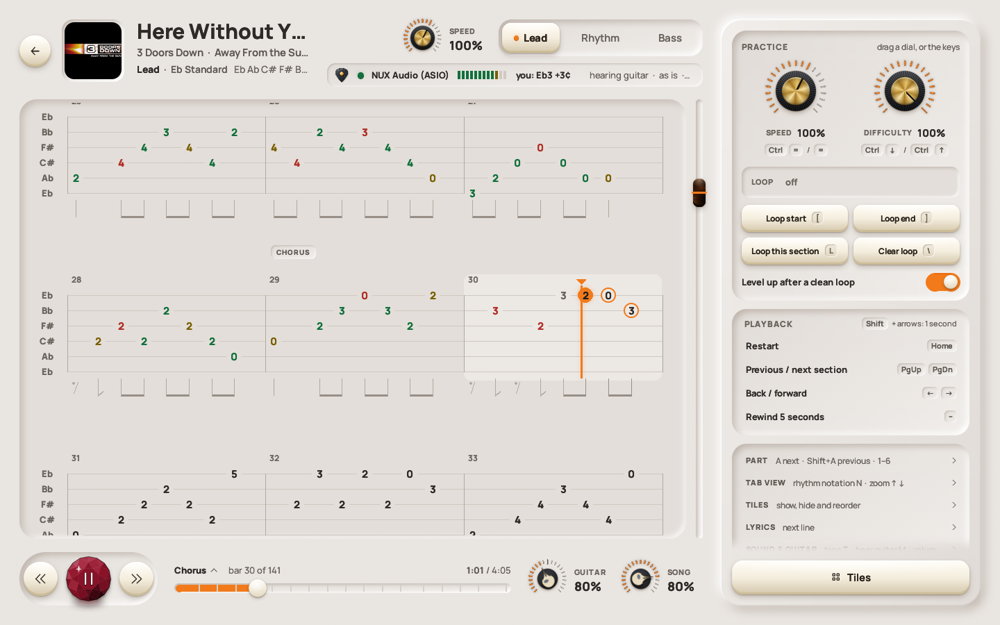 |

### 🎯 Scored as you play
Your guitar is listened to as you play. Every note counts as hit, late, early or missed, and your best runs are
kept for each part.

| Dark | Light |
|---|---|
| 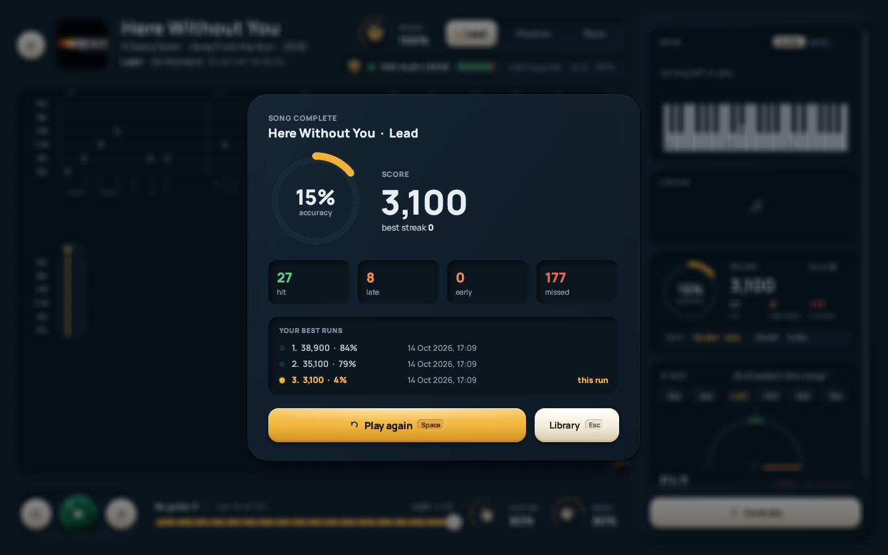 | 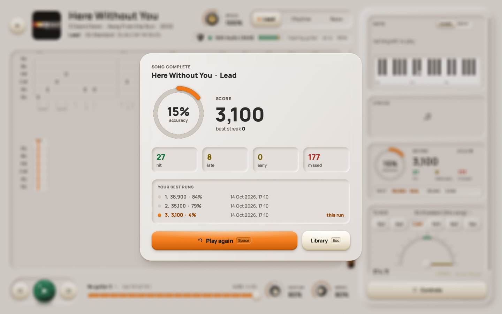 |

### 📚 Your whole library, straight away
Your songs are found by themselves, from every Steam library. You get covers, search, sorting, favourites,
playlists, a tuning filter, and a preview of the song you've selected. Home picks up where you left off.

| Dark | Light |
|---|---|
| 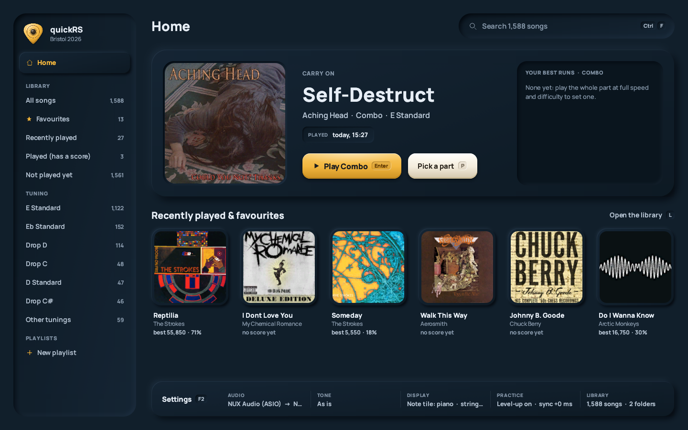 |  |
|  | 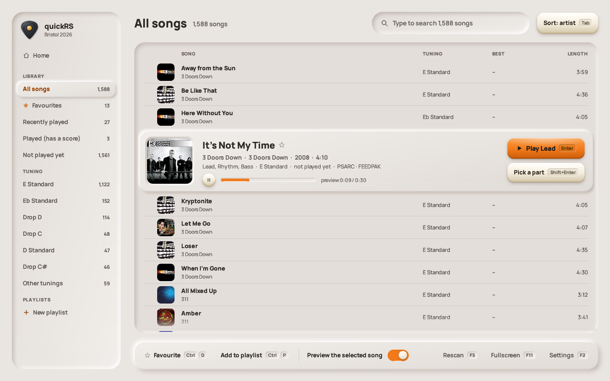 |
| 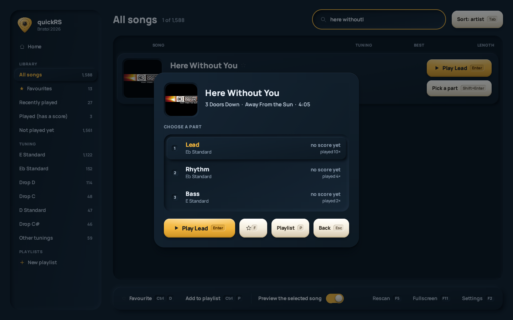 |  |

### 🎛️ Your tone, your look
Built-in guitar tones (As is, Clean, Crunch, Lead, Bass, Acoustic), or make your own with the drive, EQ and
effects knobs, and save it. Three themes: Midnight and Graphite (dark) and Daylight (light). Four knob styles.

| Dark | Light |
|---|---|
|  | 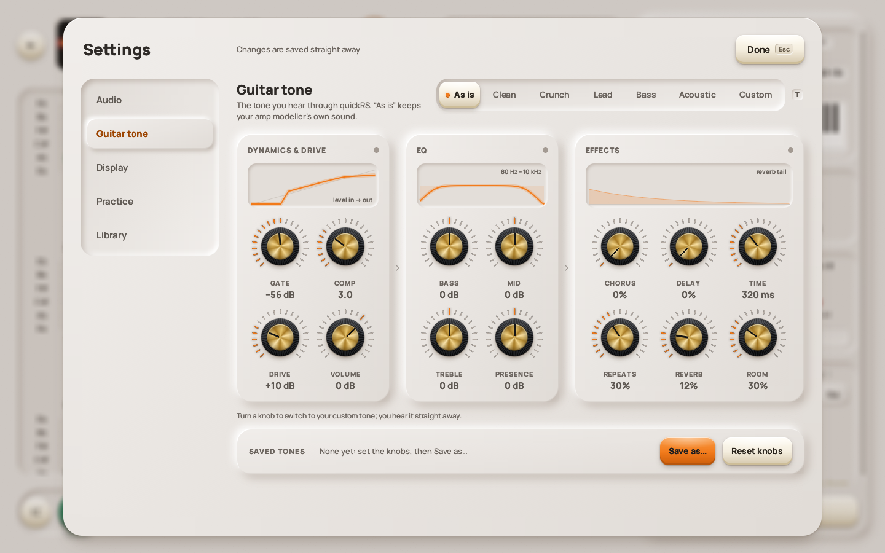 |

### 🔌 Your guitar, your way
- **Rocksmith Real Tone Cable:** plug it in and it's picked, as in Rocksmith.
- **Audio interfaces and amp modellers:** WASAPI (with a low-latency exclusive mode) or ASIO, and your RS_ASIO
  setup works too.
- **A microphone**, for an acoustic guitar.

It follows devices as you plug them in and out, and finds your guitar's channel from the first notes you play.

---

## Keys

| | |
|---|---|
| `Space` | play / pause |
| `[` `]` `L` | loop start / end / this section |
| `↑` `↓` | zoom the tab |
| `F2` | settings |
| `F11` | full screen |
| `Esc` | back |

Every page shows its keys on its buttons.

---

## ☕ Support it

quickRS is free, and it'll stay free. But vibecoding isn't free! The AI that wrote most of this code runs on
credits. If quickRS helps your practice, you can buy me a coffee:

### [**ko-fi.com/arpanmitra**](https://ko-fi.com/arpanmitra)

---

<sub>quickRS is MIT licensed. The Manrope font is SIL OFL, and ww2ogg's codebooks are BSD. quickRS isn't made by or
connected with Ubisoft. Rocksmith is a trademark of Ubisoft Entertainment. Bring your own songs.</sub>
