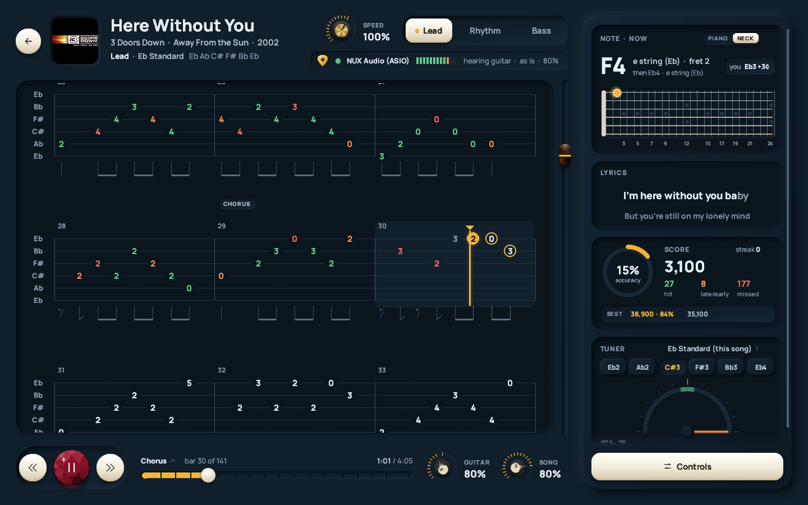
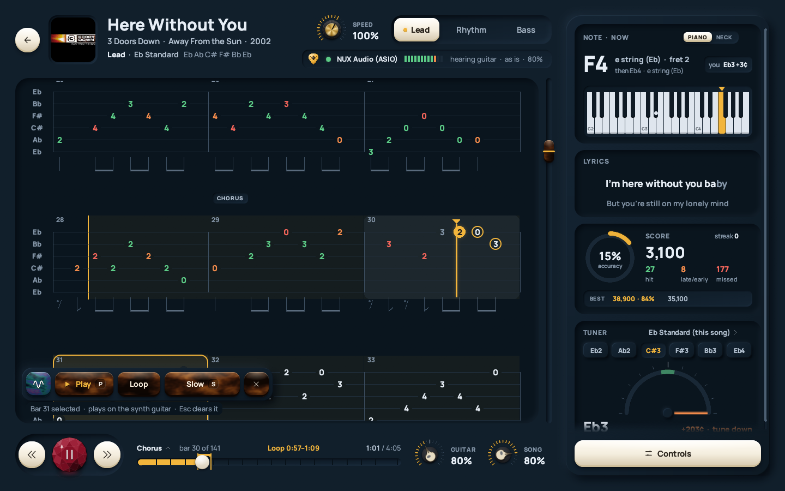
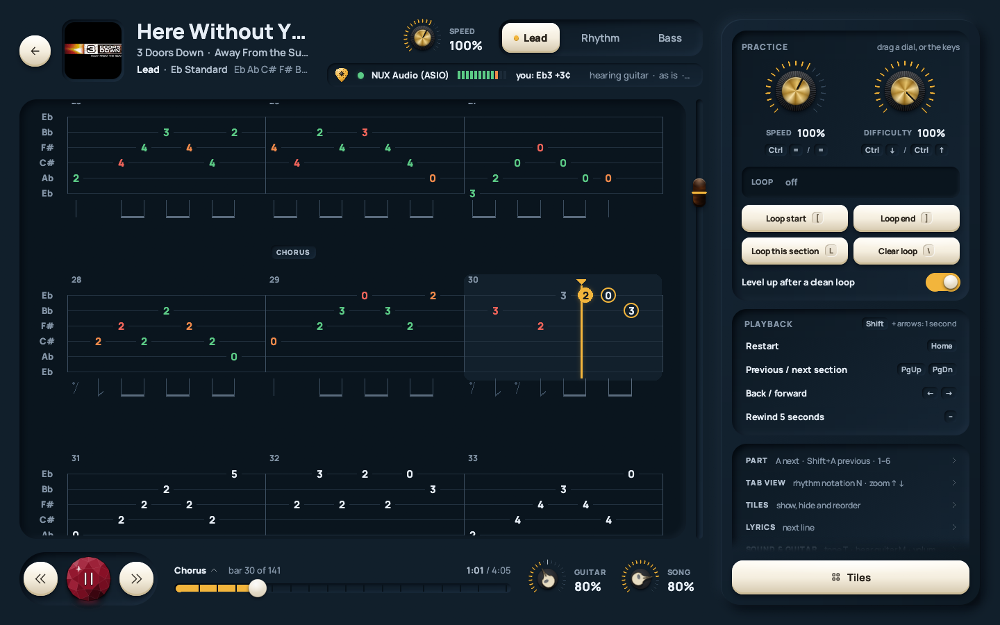
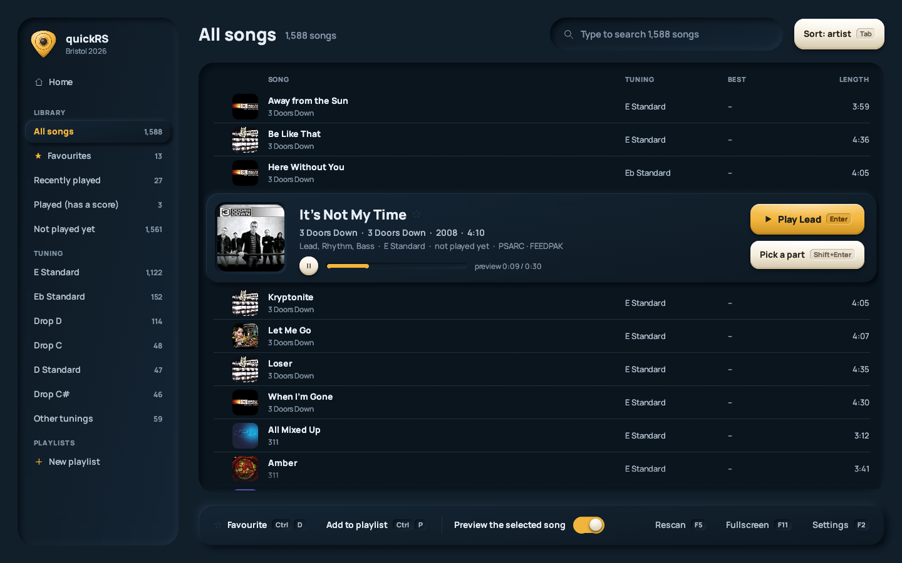
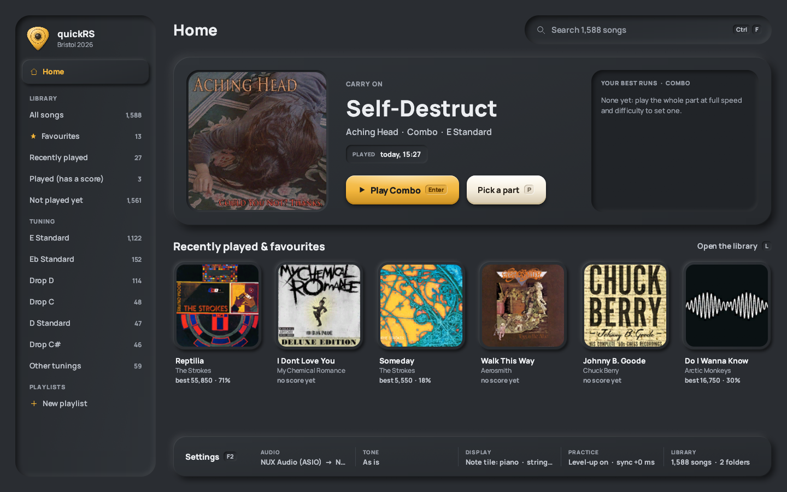

<div align="center">

# quickRS

**A free practice player for your own Rocksmith 2014 songs.**
Plug in your guitar, pick a song, and play along to tab that scrolls with the music.

[**⬇ Download for Windows**](https://github.com/arpan2711/quickRS-player/releases/latest) · [Install](#install) · [Convert to feedpaks](#convert-your-songs-to-feedpaks) · [☕ Support it](https://ko-fi.com/arpanmitra)


</div>

---

## What it does

quickRS reads the songs you already have from Rocksmith's `dlc` folder and turns them into a fast, clean practice
tool. It runs next to your Rocksmith install and never changes it.

### 🎸 Play along to real tab
The tab scrolls with the song and highlights the bar you're in, with the next notes ringed. The Lead, Rhythm and
Bass parts are one click apart, and the rhythm notation is drawn under the staff. A **note and chord panel** shows
what's coming on a piano or a guitar neck, next to the **lyrics** and a **tuner** set to the song's tuning.



### 🔁 Loop it, slow it down, level up
Drag across the tab to select a few bars and loop them. Slow the loop down **without changing the pitch**. Turn
on *Level up after a clean loop* and the difficulty steps up each time you nail it.





### 🎯 Scored as you play
Your guitar is listened to as you play. Every note counts as hit, late, early or missed, and your best runs are
kept for each part.


### 📚 Your whole library, straight away
Your songs are found by themselves, from every Steam library. You get covers, search, sorting, favourites,
playlists, a tuning filter, and a preview of the song you've selected. Home picks up where you left off.





### 🎛️ Your tone, your look
Built-in guitar tones (As is, Clean, Crunch, Lead, Bass, Acoustic), or make your own with the drive, EQ and
effects knobs, and save it. Three themes: Midnight, Graphite and Daylight. Four knob styles.


| Daylight | Graphite |
|---|---|
|  |  |

### 🔌 Your guitar, your way
- **Rocksmith Real Tone Cable:** plug it in and it's picked, as in Rocksmith.
- **Audio interfaces and amp modellers:** WASAPI (with a low-latency exclusive mode) or ASIO, and your RS_ASIO
  setup works too.
- **A microphone**, for an acoustic guitar.

It follows devices as you plug them in and out, and finds your guitar's channel from the first notes you play.

### 📦 Feedpaks: your songs in an open format
quickRS converts your .psarc files to **feedpaks**: one plain, unencrypted zip per song, with every part and
difficulty, the audio, lyrics and cover. Convert once and they need no keys. Your .psarc files are only read,
never changed.

---

## Install

1. **Download** `quickRS-<version>-windows-x64.zip` from [Releases](https://github.com/arpan2711/quickRS-player/releases/latest), then unzip it
   anywhere. There's no installer.
2. **Keys:** Rocksmith's .psarc files are encrypted, and the keys aren't included. They're published in
   open-source Rocksmith modding tools. Copy `keys.example.json` to `keys.json`, next to `quickrs.exe`, and paste
   in the two keys:
   ```json
   { "psarc_key": "<64 hex characters>", "sng_key": "<64 hex characters>" }
   ```
3. **Plug in** your Real Tone Cable or interface.
4. **Run `quickrs.exe`.** Windows may warn about an unsigned app: click *More info*, then *Run anyway*. For a
   Desktop shortcut, right-click `make_shortcut.ps1` and choose *Run with PowerShell*.

Your songs in Rocksmith's `dlc` folder show up by themselves. If a song folder is somewhere else, drag it onto the
window and it stays in your library.

**Needs:** Windows 10 or 11, 64-bit, and your own Rocksmith 2014 songs. **No songs are included.**

## Convert your songs to feedpaks

The easy way is to double-click **`Convert songs.bat`** and press Enter twice:

```
Which folder has your .psarc songs?
Press Enter for Rocksmith's own: C:\Program Files (x86)\Steam\steamapps\common\Rocksmith2014\dlc
>
Where should the feedpaks go?
Press Enter for: C:\Program Files (x86)\Steam\steamapps\common\Rocksmith2014\feedpak
>
[1/1588] The Smashing Pumpkins - 1979.feedpak
...
done: 1588 converted, 0 already there, 0 failed
```

It converts every song, including those in subfolders and every song in packs like `songs.psarc`. Run it again
after adding songs; the ones already done are skipped.

**Setting up the feedpak folder:** leave it at the default, a `feedpak` folder next to `dlc`, and quickRS finds it
on every start. If you put it anywhere else, drag the folder onto the quickRS window once. If you have a song as
both a .psarc and a feedpak, it shows once, and *Settings → Library* chooses which copy plays.

From a command prompt:

```bat
quickrs-cli.exe convert-folder "C:\...\Rocksmith2014\dlc" "C:\...\Rocksmith2014\feedpak"
quickrs-cli.exe feedpak "C:\...\dlc\somesong_p.psarc" -o "Some Song.feedpak"
```

## Keys

| | |
|---|---|
| `Space` | play / pause |
| `[` `]` `L` | loop start / end / this section |
| `Ctrl` + `=` / `-` | faster / slower |
| `↑` `↓` | zoom the tab |
| `F2` | settings |
| `F11` | full screen |
| `Esc` | back |

Every page shows its keys on its buttons.

---

## ☕ Support it

quickRS is free, and it'll stay free. But vibecoding isn't free! The AI that wrote most of this code runs on
credits. If quickRS helps your practice, you can buy me a coffee:

### [**ko-fi.com/arpanmitra**](https://ko-fi.com/arpanmitra)

---

<sub>quickRS is MIT licensed. The Manrope font is SIL OFL, and ww2ogg's codebooks are BSD. quickRS isn't made by or
connected with Ubisoft. Rocksmith is a trademark of Ubisoft Entertainment. Bring your own songs.</sub>
