<div align="center">

# quickRS

**A free practice player for your own Rocksmith 2014 songs.**
Plug in your guitar, pick a song, and play along to tab that scrolls with the music.

[**⬇ Download for Windows**](https://github.com/arpan2711/quickRS-player/releases/latest) · [Get your songs in](#get-your-songs-in) · [Converter](#the-converter-psarc--feedpak) · [Build it yourself](#build-it-yourself) · [☕ Support it](https://ko-fi.com/arpanmitra)

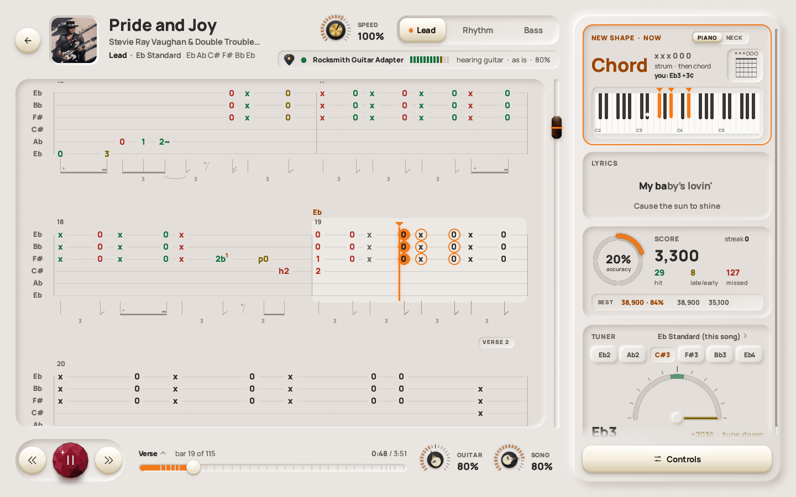

</div>

## Get your songs in

1. **Download** `quickRS-<version>-windows-x64.zip` from
   [Releases](https://github.com/arpan2711/quickRS-player/releases/latest) and unzip it anywhere. There's no
   installer. (Everything that's in the zip is also in the [`quickRS`](quickRS) folder here, ready to run:
   *Code → Download ZIP* gets it too. The rest of this repo is the source: see
   [Build it yourself](#build-it-yourself).)

   | File | What it's for |
   |---|---|
   | `quickrs.exe` | the player |
   | `quickRS Converter.exe` | converts your .psarc songs to feedpaks, in a window |
   | `Convert songs.bat` | the same, in a console |
   | `quickrs-cli.exe` | command-line tools (the converter, song info, tabs) |
   | `keys.example.json` | where you paste Rocksmith's two keys (step 2) |
   | `make_shortcut.ps1` | puts a quickRS shortcut on your Desktop |
   | `README.txt` | these instructions, offline |
2. **Add Rocksmith's two keys.** Rocksmith's .psarc song files are locked (encrypted), and quickRS needs two keys
   to unlock them. Each key is a code 64 characters long, made of `0`-`9` and `A`-`F`. They're the same in every
   copy of Rocksmith, so they aren't a licence key and have nothing to do with your Steam account. quickRS can't
   ship them, but they're published in open-source Rocksmith modding tools: the *PSARC key* and the *SNG key for
   PC*. When you have them:
   1. Open `keys.example.json` in Notepad: right-click it, then *Open with* → *Notepad*. It has two lines like
      this one:
      ```
      "psarc_key": "<replace all of this, < and > too, with the PSARC key>",
      ```
   2. On each line, delete the text between the two quotes, `<` and `>` included, and paste the key there. Leave
      the quotes and the comma as they are, and keep the key on one line. A key written as `0x1A, 0x2B, …` works
      too.
   3. Click *File* → *Save as*. Keep the same folder, type `"keys.json"` as the file name (with the quotes, so
      Windows doesn't add `.txt`), and click *Save*.
   4. To check, open `quickRS Converter.exe`. Its top line says **Keys found**, or says what's wrong with
      `keys.json`.
   5. **If you've already run quickRS, press F5 in it** (*Rescan*, on the library's bottom bar). quickRS
      remembers which songs it couldn't read, and only checks them again on a rescan; until then they stay
      *needs keys* even with the keys in place.

   Until the keys are in, your .psarc songs are listed with *needs keys* and don't play. Songs still say *needs
   keys* after you've added them? Press **F5**. Feedpaks (below) don't need keys.
3. **Run `quickrs.exe`.** Your songs in Rocksmith's `dlc` folder are listed straight away, with nothing to convert
   or set up. Songs somewhere else? Drag that folder onto the quickRS window and it stays in your library.
4. **Optional: convert them to feedpaks** with **`quickRS Converter.exe`** (below).

Windows may warn about an unsigned app the first time: click *More info*, then *Run anyway*. For a Desktop
shortcut, right-click `make_shortcut.ps1` and choose *Run with PowerShell*.
**Needs:** Windows 10 or 11 (64-bit), your guitar (a Real Tone Cable, an audio interface, or a mic), and your own
Rocksmith 2014 songs. **No songs are included.**

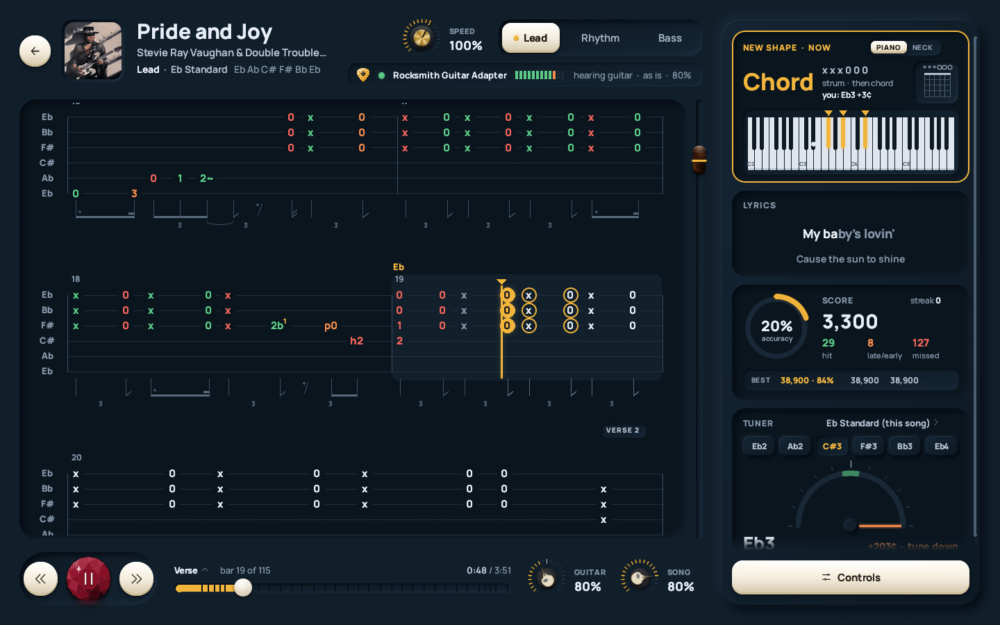

## The converter: psarc → feedpak

**Feedpaks** are an open format for the same songs: one plain, unencrypted zip per song, with every part and
difficulty, the audio, lyrics and cover. Once converted, they play without keys. Your .psarc files are only read,
never changed, so Rocksmith keeps working as before.

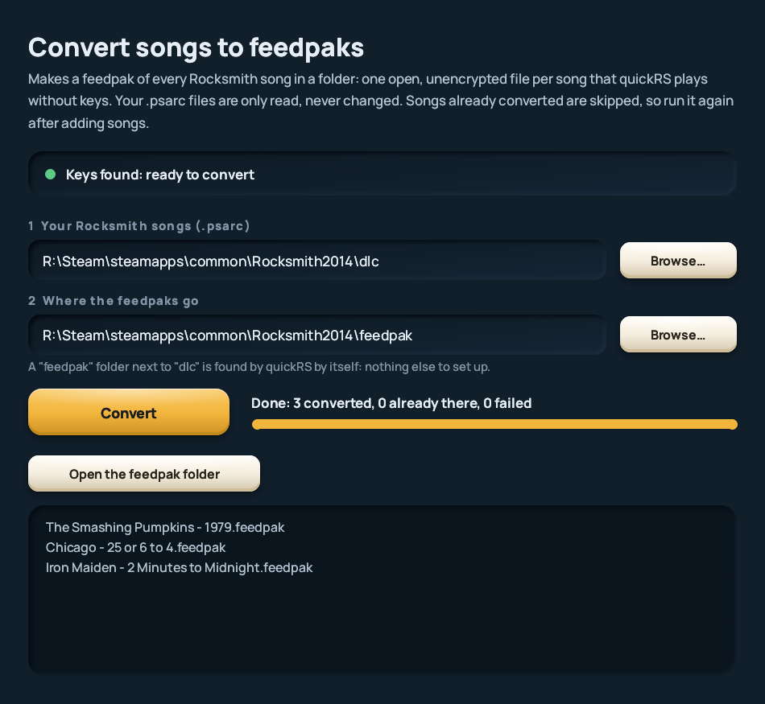

**How to use it:**

1. Double-click **`quickRS Converter.exe`** (it's in the zip, next to `quickrs.exe`).
2. Check the top line says **Keys found**. If it doesn't, it says what's wrong: add or fix `keys.json` (step 2
   above), then press *Check again*.
3. **Your Rocksmith songs:** Rocksmith's `dlc` folder is filled in when it's found. If it isn't, press *Browse…*
   and pick the folder with your .psarc files.
4. **Where the feedpaks go:** it fills in a `feedpak` folder next to `dlc`. **Leave it** and quickRS finds your
   feedpaks by itself, with nothing to set up. If you choose somewhere else, drag that folder onto the quickRS
   window once afterwards.
5. Press **Convert**. Each song shows as it's done, and *Open the feedpak folder* shows you the result.

It converts every song, including those in subfolders and every song in packs like `songs.psarc`. Run it again
after buying or adding songs, and only the new ones are converted. If you have a song as both a .psarc and a
feedpak, quickRS shows it once, and *Settings → Library* chooses which copy plays.

**No window?** `Convert songs.bat` does the same in a console: double-click it and press Enter twice. From a
command prompt:

```bat
quickrs-cli.exe convert-folder "C:\...\Rocksmith2014\dlc" "C:\...\Rocksmith2014\feedpak"
```

---

## What it does

quickRS reads the songs you already have and turns them into a fast, clean practice tool. It runs next to your
Rocksmith install and never changes it.

### 🎸 Play along to real tab
The tab scrolls with the song and highlights the bar you're in, with the next notes ringed. The Lead, Rhythm and
Bass parts are one click apart, and the rhythm notation is drawn under the staff. Next to the tab are the **lyrics**,
a **tuner** set to the song's tuning, and the **note panel**.

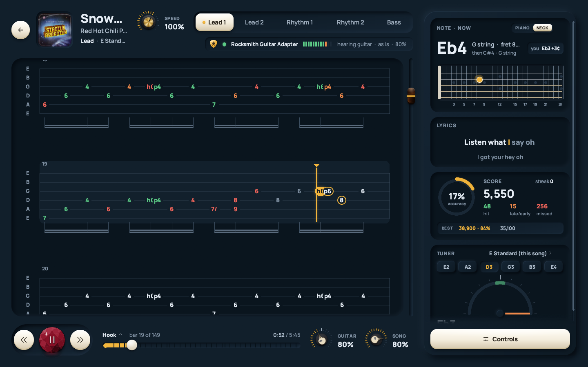

**The note panel** shows what's coming next: a chord on a piano, with its shape and fingering, or a single note on
the guitar neck, with the string and fret. It also shows the note it hears you play ("you: Eb3 +3¢").

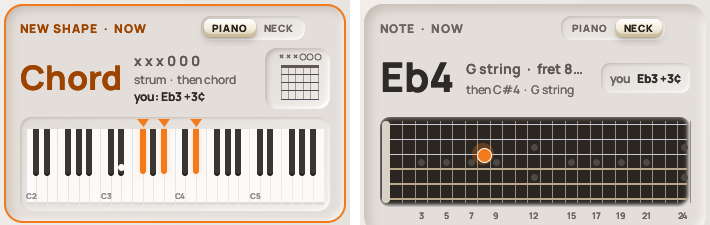

Move the tiles around, or turn off the ones you don't need. Here the tuner is at the top:

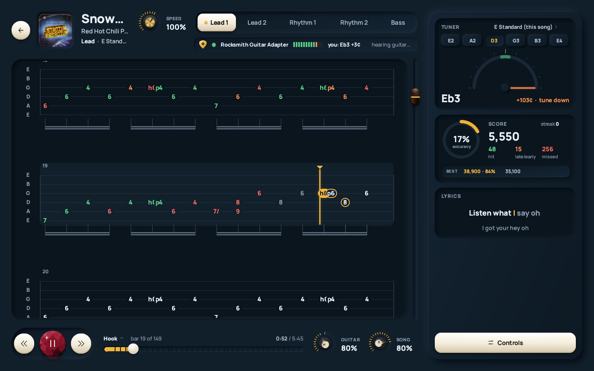

### 🔁 Loop it, slow it down, level up
**Loop a section:** `[` and `]` set the loop's start and end (snapped to the beat, with a short lead-in each time
round), and `L` loops the section you're in. The loop shows on the tab and on the seek bar:

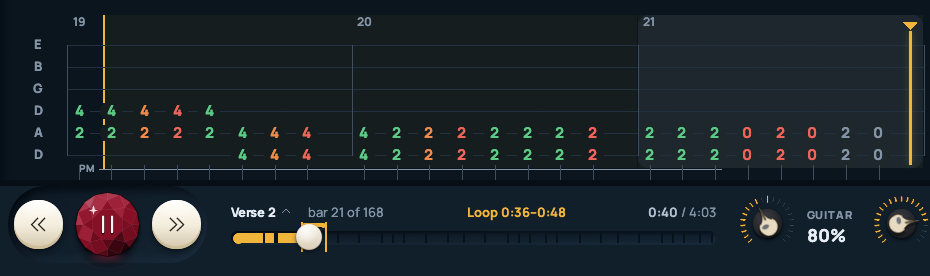

**Hear a passage on its own:** Ctrl+drag across some bars (or Ctrl+click a bar) to select them. A bar of keys pops
up under the selection: **Play** (`P`) plays it once, **Loop** repeats it, and **Slow** (`S`) takes it to 70%, then
50%, without changing the pitch. The key on the left chooses what you hear:

- **The synth guitar** (the wave): only the notes in the tab, played on a synthesised guitar, so you hear exactly
  what's written, even at 50% speed.
- **The song** (the bars): the real recording of that passage, with the band.

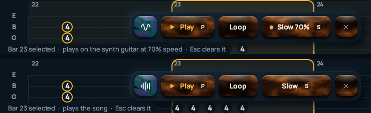

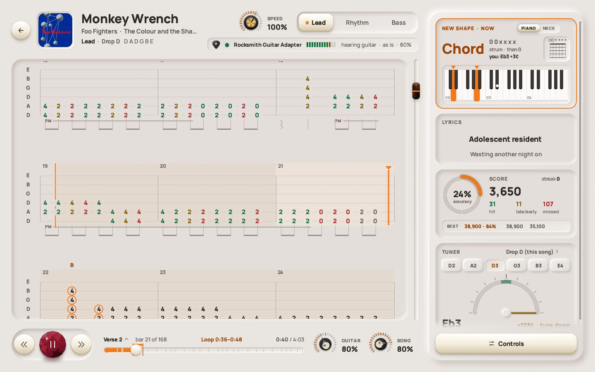

**Slow the whole song down** with the speed knob (25% to 150%, the pitch stays the same). **Jump to any section**
from the list over the seek bar, or with PgUp and PgDn:

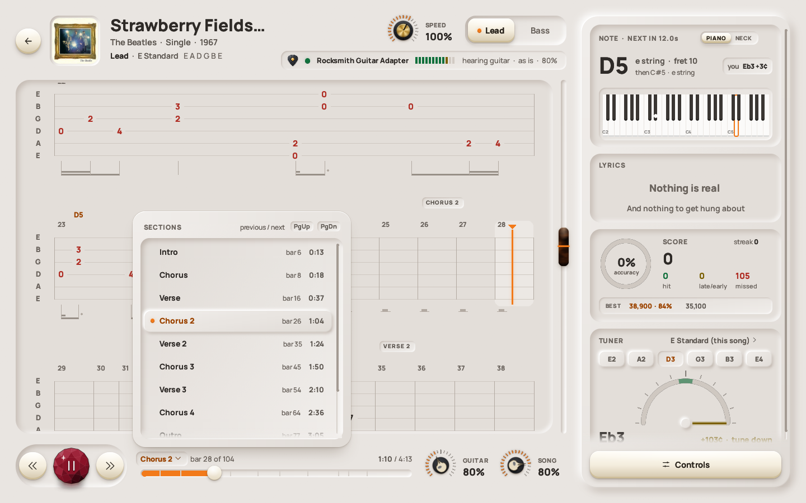

**Practice controls** (the *Controls* key) have it all in one place: speed, difficulty, the loop keys, and
*Level up after a clean loop*, which steps the difficulty up each time you nail the loop.

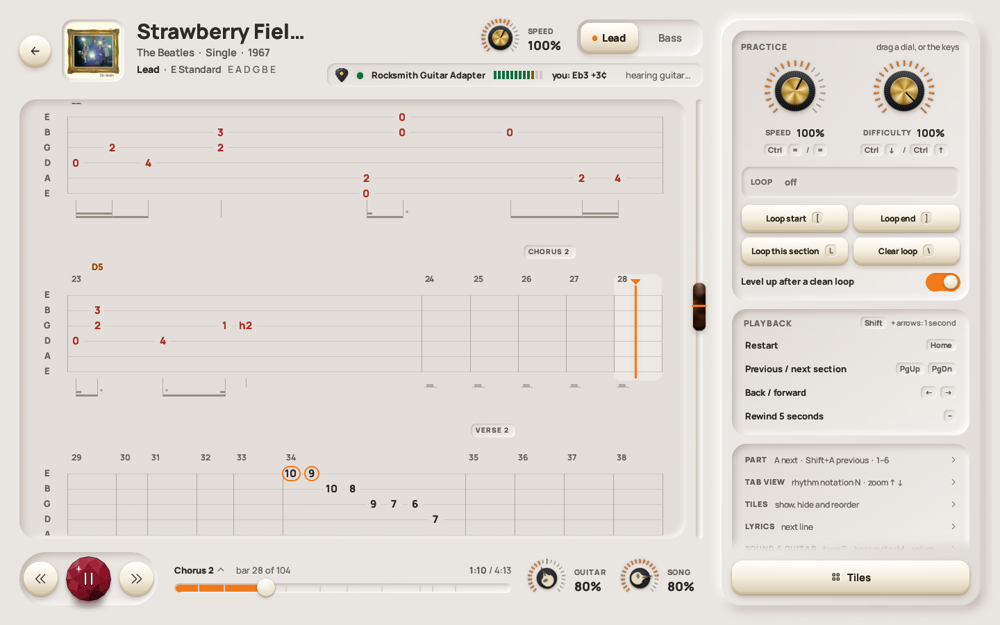

### 🎯 Scored as you play
Your guitar is listened to as you play. Every note counts as hit, late, early or missed, and your best runs are
kept for each part.


### 📚 Your whole library, straight away
Your songs are found by themselves, from every Steam library. You get covers, search, sorting, favourites,
playlists, a tuning filter, and a preview of the song you've selected. Home picks up where you left off.

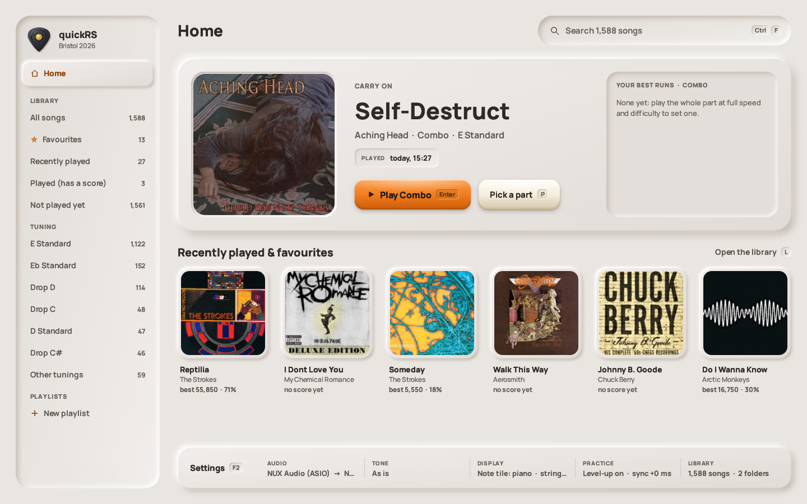


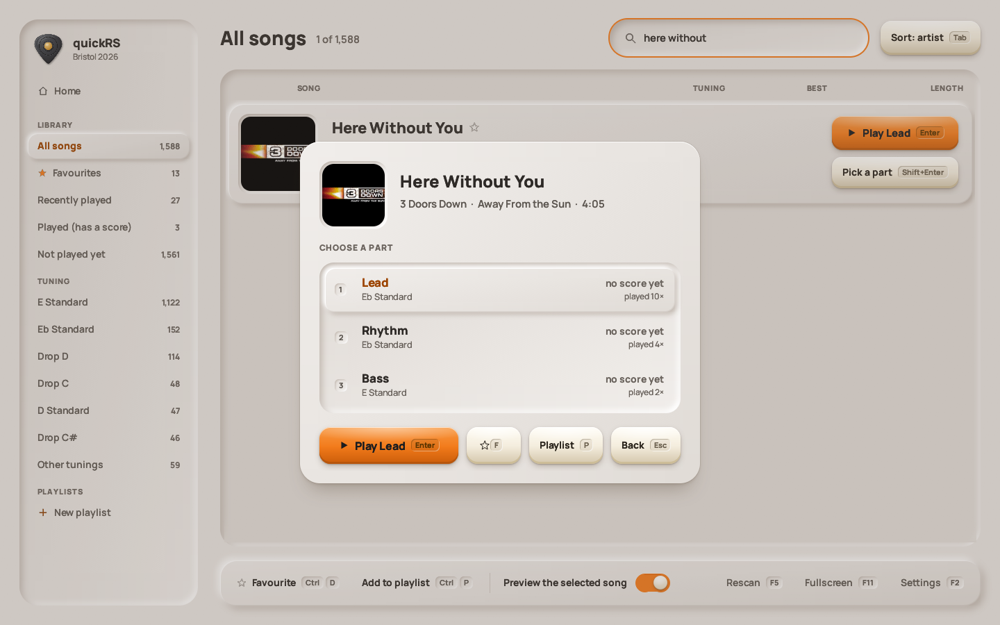

### 🎛️ Your tone, your look
Built-in guitar tones (As is, Clean, Crunch, Lead, Bass, Acoustic), or make your own with the drive, EQ and
effects knobs, and save it. Three themes: Midnight and Graphite (dark) and Daylight (light). Four knob styles.

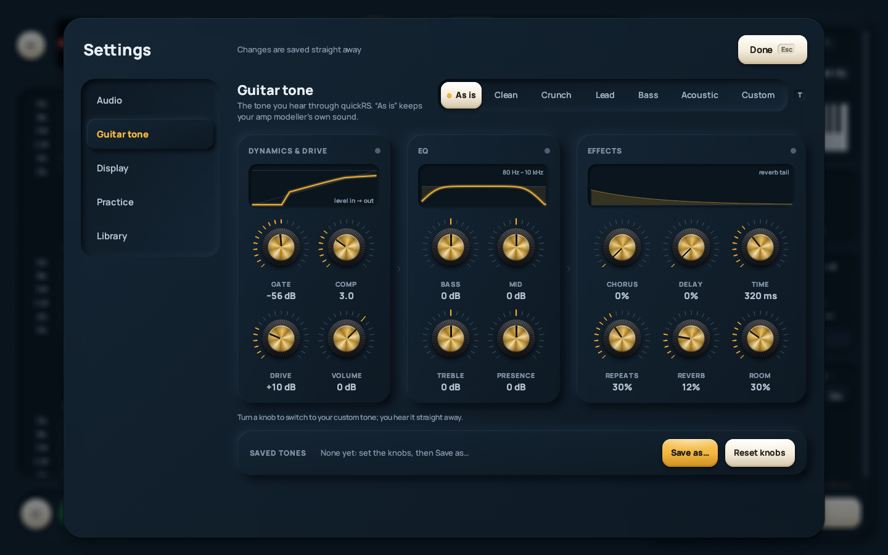

### 🔌 Your guitar, your way
- **Rocksmith Real Tone Cable:** plug it in and it's picked, as in Rocksmith.
- **Audio interfaces and amp modellers:** WASAPI (with a low-latency exclusive mode) or ASIO, and your RS_ASIO
  setup works too.
- **A microphone**, for an acoustic guitar.

It follows devices as you plug them in and out, and finds your guitar's channel from the first notes you play.

---

## Build it yourself

The whole program is here as Rust source (MIT), the same code as the release.

| Folder | What's in it |
|---|---|
| [`quickRS/`](quickRS) | the program, built and ready to run (the release zip's contents) |
| `crates/qrs-app` | the player, `quickrs.exe` |
| `crates/qrs-convert` | the converter window, `quickRS Converter.exe` |
| `crates/qrs-cli` | the command-line tools, `quickrs-cli.exe` (converter, song info, tabs, devices) |
| `crates/qrs-formats` | Rocksmith 2014 psarc / sng / xml and feedpak, the chart model, tab rendering |
| `crates/qrs-audio` | the audio engine: WASAPI and ASIO devices, tones, decoding, slow-down, the synth |
| `crates/qrs-analysis` | pitch, onset and note detection, scoring |
| `crates/qrs-library` | the library scan, settings and user data, the feedpak exporter |
| `crates/qrs-ui` | the look: themes, fonts, components |
| `share/` | the release's readme, `Convert songs.bat`, and `package.ps1`, which makes the release zip |

**You need** (Windows 10 or 11, 64-bit):
- [Rust](https://rustup.rs) (stable) with the MSVC toolchain, and the *Visual Studio Build Tools* with
  *Desktop development with C++*.
- [LLVM](https://github.com/llvm/llvm-project/releases), for the ASIO support: set `LIBCLANG_PATH` to its `bin`
  folder. The ASIO SDK is downloaded by the build.

**Build and run:**

```bat
cargo build --release -p qrs-app -p qrs-cli -p qrs-convert
cargo run --release -p qrs-app
cargo test --workspace
powershell -ExecutionPolicy Bypass -File share\package.ps1
```

The programs land in `target/release`; `package.ps1` makes the release zip in `dist\share`. For your songs,
put `keys.json` in the folder you run from (it's in `.gitignore`), as in step 2 above.

---

## Keyboard shortcuts

| | |
|---|---|
| `Space` | play / pause |
| `[` `]` `L` | loop start / end / this section |
| `↑` `↓` | zoom the tab |
| `F2` | settings |
| `F11` | full screen |
| `Esc` | back |

Every page shows its keys on its buttons.

---

## ☕ Support it

quickRS is free, and it'll stay free. But vibecoding isn't free! The AI that wrote most of this code runs on
credits. If quickRS helps your practice, you can buy me a coffee:

### [**ko-fi.com/arpanmitra**](https://ko-fi.com/arpanmitra)

---

<sub>quickRS is MIT licensed. The Manrope font is SIL OFL, and ww2ogg's codebooks are BSD. quickRS isn't made by or
connected with Ubisoft. Rocksmith is a trademark of Ubisoft Entertainment. Bring your own songs.</sub>
